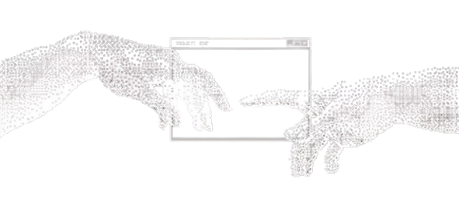

  

<h1 align="center">Hi 👋, Jayvee Nacino</h1>

<h3 align="center">Software Engineer</h3>

  

Building innovative software solutions through clean code, scalable architecture, and efficient engineering.

##  <h2 align="center">🚀 About Me </h2>

**Jayvee**, Here  — a final-year Computer Engineering student passionate about software engineering and backend development.

I enjoy designing and building scalable, reliable, and production-ready applications, with a strong focus on clean code, efficient architecture, and practical solutions.

Currently, I'm exploring FastAPI, PostgreSQL, SQLAlchemy, Docker, and Redis, while strengthening my foundation in Data Structures & Algorithms and software development best practices.

My goal is simple: build meaningful software, solve real-world problems, and continuously grow into an engineer who creates reliable systems that make a difference.  

 

 <h2 align="center">🤝 Connect</h2>

  
  &nbsp;&nbsp;&nbsp;
  
  &nbsp;&nbsp;&nbsp;
  

<h2 align="center">💻 Tech Stack</h2>

  

  <!-- Frontend -->
  
  &nbsp;&nbsp;
  
  &nbsp;&nbsp;
  
  &nbsp;&nbsp;
  
  &nbsp;&nbsp;
  
  &nbsp;&nbsp;

  <!-- Languages -->
  
  &nbsp;&nbsp;
  
  &nbsp;&nbsp;
  
  &nbsp;&nbsp;

  <!-- Backend -->
  
  &nbsp;&nbsp;
  
  &nbsp;&nbsp;

  <!-- Database -->
  
  &nbsp;&nbsp;
  
  &nbsp;&nbsp;
  
  &nbsp;&nbsp;

  <!-- Tools & DevOps -->
  
  &nbsp;&nbsp;
  
  &nbsp;&nbsp;
  
  &nbsp;&nbsp;
  
  &nbsp;&nbsp;
  

<h2 align="center">📊 GitHub Stats</h2>

  

<h2 align="center">📈 Contribution Activity</h2>

  

<h2 align="center">⌘ Contribution Graph</h2>

  <picture>
    <source media="(prefers-color-scheme: dark)"
      srcset="https://raw.githubusercontent.com/midnightshady/midnightshady/output/pacman-contribution-graph-dark.svg">
    <source media="(prefers-color-scheme: light)"
      srcset="https://raw.githubusercontent.com/midnightshady/midnightshady/output/pacman-contribution-graph.svg">
    
  </picture>

<h2 align="center">⌘ Developer Philosophy</h2>

  

